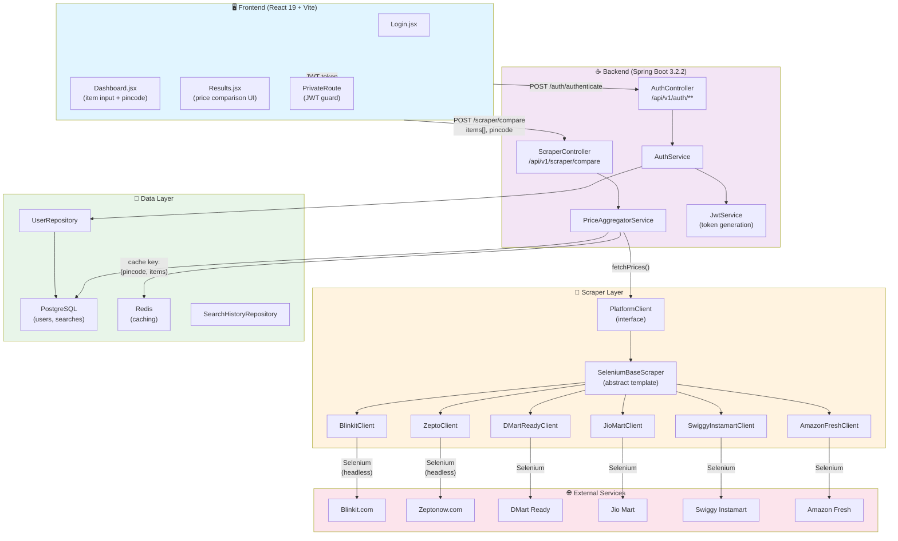

## 🚀 EXECUTIVE SUMMARY & CORE ENGINE

**What problem does this application solve?**

CartWise solves the "Price Fragmentation Problem" in Indian quick-commerce. Indian grocery shoppers face this harsh reality: the same product (e.g., "1L Amul Milk") costs ₹48 on Blinkit, ₹52 on Zepto, ₹45 on DMart Ready, ₹50 on Swiggy Instamart, etc. Users must manually visit 6+ platforms to find the cheapest option. CartWise automates this by scraping real-time prices from 6 major quick-commerce platforms and presenting a unified price comparison dashboard. **Target users**: Cost-conscious Indian consumers shopping for groceries/household items, typically in metro cities (where all 6 platforms operate).

**Core Engine: The Concurrent Price Aggregation Pipeline**

The application's heartbeat is the **PriceAggregatorService** which:

1. Accepts a list of items (product names + quantities) and a pincode
2. Spawns 6 **concurrent Selenium WebDriver instances** (one per platform) running in headless Chrome
3. Each driver navigates to a platform's homepage → sets location → searches for each product → extracts prices
4. All 6 drivers run in parallel with a 90-second timeout per platform
5. Results are sorted by total cart cost (cheapest first)

**Critical files housing the core logic:**

- `PriceAggregatorService.java` — orchestrates concurrent fetching and sorting
- `SeleniumBaseScraper.java` — base template for all scrapers
- `SeleniumService.java` — manages WebDriver lifecycle

---

## 🏗️ SYSTEM ARCHITECTURE & DATA LIFECYCLE

**Design Paradigm:** Hybrid **Hexagonal Architecture (Ports & Adapters)** + **Repository Pattern**

- **Ports**: `PlatformClient` interface (defines contract for any platform scraper)
- **Adapters**: 6 concrete implementations (BlinkitClient, ZeptoClient, etc.) encapsulating platform-specific DOM traversal
- **Repository**: JPA entities for User, SearchHistory, SearchItem; repositories follow Spring Data conventions
- **Service Layer**: Business logic sits in AuthService, PriceAggregatorService, SeleniumService
- **Controller Layer**: REST endpoints in AuthController, ScraperController

**Component Diagram:**



**User Journey: Tracing a Price Comparison API Call** (The Sacred Path)

```
1. USER INITIATES [Dashboard → Results Navigation]
   └─ Frontend: Dashboard.jsx line ~37
      └─ onClick handleCompare()
         └─ Navigates to /results with state={items, pincode}
         └─ Results.jsx mounts → calls fetchResults() [line ~27]

2. API REQUEST DISPATCH
   └─ Frontend: services/api.js line ~16
      └─ POST /api/v1/scraper/compare?pincode=560001
      └─ Payload: [{ itemName: "Milk 1L", quantity: "1" }]
      └─ Axios adds Authorization header with JWT token

3. BACKEND RECEIVES
   └─ Backend: ScraperController.java line ~20
      └─ @PostMapping("/compare")
      └─ Parameters: pincode="560001", items=[SearchItem{...}]

4. PRICE AGGREGATOR ORCHESTRATES
   └─ Backend: PriceAggregatorService.comparePrices() [line ~23]
      a) @Cacheable check: Does cache key (pincode, items.hashCode()) exist?
         └─ If YES → return cached PlatformResult[] immediately

      b) If NO → Create CompletableFuture<PlatformResult> for EACH of 6 clients:
         └─ platformClients.stream() → [BlinkitClient, ZeptoClient, DMartClient, JioMartClient, SwiggyInstamartClient, AmazonFreshClient]

         └─ For EACH client:
            1. client.fetchPrices(items, pincode)  [Returns CompletableFuture]
            2. .orTimeout(90000, MILLISECONDS)  [90-second deadline]
            3. .exceptionally(ex -> PlatformResult{errorMessage, available=false})

         └─ futures.stream().map(CompletableFuture::join)  [WAIT for all 6 to complete or timeout]

      c) SORT results by totalAmount ascending (cheapest first)
         └─ Filter available results first, then by price
         └─ Return sorted List<PlatformResult>

5. SELENIUM SCRAPING (Inside each client, runs in parallel thread pool)
   └─ Example: BlinkitClient.fetchPrices() [line ~28 of SeleniumBaseScraper]

      a) selesiumService.createDriver()
         └─ WebDriverManager.chromedriver().setup()  [Auto-downloads ChromeDriver]
         └─ new ChromeDriver(options)  [headless, 1920x1080 viewport]
         └─ Timeouts: pageLoad=45s, implicit=10s, script=30s

      b) driver.get("https://blinkit.com")  [Navigate]

      c) setLocation(driver, wait, "560001")  [Platform-specific]
         └─ BlinkitClient.setLocation() [line ~40 of BlinkitClient]
         └─ Wait for location header → Click
         └─ Type "560001" in search input (XPath pattern-matched)
         └─ Click first autocomplete result
         └─ Handle map confirmation dialog (if present)
         └─ Thread.sleep(2000) for JS rendering

      d) FOR EACH item in items:
         └─ extractPrice(driver, wait, item)  [Platform-specific]
         └─ BlinkitClient.extractPrice() [line ~75]
         └─ Click search bar → clear → sendKeys("Milk")
         └─ Wait for product results
         └─ Find first price element with XPath "//div[contains(text(), '₹')]"
         └─ Parse: "₹125" → 125.0
         └─ Accumulate total += 125.0

      e) driver.quit()  [Kill browser process]

      f) RETURN: PlatformResult{
            platformName: "Blinkit",
            totalAmount: 125.0,
            items: [...],
            available: true
         }

      On ANY exception:
      └─ Return: PlatformResult{
            platformName: "Blinkit",
            errorMessage: "Timeout or Error: ...",
            available: false
         }

6. RESPONSE ASSEMBLY & CACHING
   └─ PriceAggregatorService combines all 6 results
   └─ Sorts by totalAmount (available first, then by price)
   └─ @Cacheable stores in Redis [currently disabled in config]
   └─ Returns: [{
        platformName: "DMart Ready",
        totalAmount: 110.0,  ← CHEAPEST
        available: true
      }, {
        platformName: "Blinkit",
        totalAmount: 125.0,
        available: true
      }, ...]

7. FRONTEND RENDERS
   └─ Results.jsx [line ~43]
   └─ Maps PlatformResult[] into ResultCard components
   └─ Displays prices, sorted by cheapest first
   └─ Shows "Available" status and error messages
```

---

## 🗺️ DIRECTORY TOUR & CRITICAL FILES

**Top 5 Must-Read Files (In Priority Order)**

| Priority | File                          | Size       | Why It's Critical                                                                                                                                                                                                                    |
| -------- | ----------------------------- | ---------- | ------------------------------------------------------------------------------------------------------------------------------------------------------------------------------------------------------------------------------------ |
| 1        | `PriceAggregatorService.java` | ~40 lines  | **The heartbeat.** Orchestrates all 6 concurrent Selenium drivers. Every price comparison flows through this single service. Understand the CompletableFuture pattern, caching, and timeout logic.                                   |
| 2        | `SeleniumBaseScraper.java`    | ~75 lines  | **The template.** Abstract base class defining the `fetchPrices()` lifecycle for all 6 platform scrapers. Shows DOM wait strategies, error handling, and browser lifecycle management. All platform clients extend this.             |
| 3        | `SeleniumService.java`        | ~35 lines  | **The driver factory.** Manages ChromeDriver instantiation, headless options, and timeouts. Critical because each concurrent thread spawns a new WebDriver—this is the bottleneck.                                                   |
| 4        | `api.js`                      | ~15 lines  | **The bridge.** Axios client with JWT token injection. Shows how frontend intercepts requests to add Authorization headers. Defines all 3 API endpoints: `/auth/authenticate`, `/auth/register`, `/scraper/compare`.                 |
| 5        | `BlinkitClient.java`          | ~110 lines | **A real scraper.** Concrete implementation showing XPath-based DOM traversal, WebDriverWait patterns, and platform-specific quirks (location modal, search bar, price extraction). Replicate this pattern for adding new platforms. |

**Detailed Directory Structure & Responsibilities:**

```
backend/
├── pom.xml
│   └─ Spring Boot 3.2.2, Java 17, Maven
│   └─ Dependencies: Data JPA, Security, WebFlux, Selenium, JSoup, JJWT, WebDriver Manager
│
├── src/main/java/com/cartwise/
│   ├── BackendApplication.java
│   │   └─ @EnableCaching, @EnableAsync → enables Redis and async task execution
│   │
│   ├── config/
│   │   ├── ApplicationConfig.java
│   │   │   └─ Defines AuthenticationManager, PasswordEncoder beans
│   │   ├── JwtAuthenticationFilter.java
│   │   │   └─ Intercepts requests, extracts JWT from "Bearer {token}" header
│   │   ├── JwtService.java
│   │   │   └─ Generates/validates JWT tokens (24-hour expiry), uses HS256 algorithm
│   │   ├── SecurityConfig.java
│   │   │   └─ CORS: allows http://localhost:5173 (Vite dev server)
│   │   │   └─ CSRF disabled (stateless API)
│   │   │   └─ Permits /api/v1/auth/** and /api/v1/scraper/** publicly
│   │   └── WebClientConfig.java
│   │       └─ Configures Spring WebClient with 2s timeout (for fallback HTTP requests, not Selenium)
│   │
│   ├── controller/
│   │   ├── AuthController.java
│   │   │   └─ POST /api/v1/auth/register → AuthService.register()
│   │   │   └─ POST /api/v1/auth/authenticate → AuthService.authenticate()
│   │   └── ScraperController.java
│   │       └─ POST /api/v1/scraper/compare → PriceAggregatorService.comparePrices()
│   │
│   ├── dto/
│   │   ├── AuthDtos.java
│   │   │   └─ RegisterRequest{fullName, email, password}
│   │   │   └─ AuthenticationRequest{email, password}
│   │   │   └─ AuthenticationResponse{token}
│   │   └── PlatformResult.java
│   │       └─ Returned by all scrapers; wraps platform name, total price, items, availability
│   │       └─ Nested ItemResult{originalName, matchedName, price, originalPrice, quantity, imageUrl, inStock}
│   │
│   ├── exception/
│   │   └── GlobalExceptionHandler.java
│   │       └─ @ControllerAdvice catches all exceptions → returns JSON error response
│   │
│   ├── model/
│   │   ├── User.java
│   │   │   └─ JPA entity, implements UserDetails (Spring Security)
│   │   │   └─ Fields: id, email (unique), password (hashed), fullName
│   │   ├── SearchHistory.java
│   │   │   └─ JPA entity for persisting user search history (currently unused)
│   │   └── SearchItem.java
│   │       └─ JPA entity; belongs to SearchHistory
│   │       └─ Fields: id, searchHistory FK, itemName, quantity
│   │
│   ├── repository/
│   │   ├── UserRepository.java
│   │   │   └─ findByEmail(String) → custom query
│   │   ├── SearchHistoryRepository.java
│   │   │   └─ Unused; for future feature
│   │   └── SearchItemRepository.java
│   │       └─ Unused; for future feature
│   │
│   ├── scraper/
│   │   ├── PlatformClient.java
│   │   │   └─ Interface: fetchPrices(items, pincode) → CompletableFuture<PlatformResult>
│   │   │   └─ Interface: getPlatformName() → String
│   │   ├── BaseScraperClient.java
│   │   │   └─ Abstract base for HTTP/API-based scrapers (fallback; not currently used)
│   │   │   └─ Provides: WebClient, session cookie management, user agent rotation, GET/POST helpers
│   │   ├── SeleniumBaseScraper.java
│   │   │   └─ ★ Abstract base for Selenium-based scrapers
│   │   │   └─ Defines: fetchPrices() template method
│   │   │   └─ Subclasses must implement: getBaseUrl(), setLocation(), extractPrice()
│   │   │   └─ Handles: WebDriver lifecycle, CompletableFuture wrapping, error handling
│   │   │
│   │   └── impl/
│   │       ├── BlinkitClient.java      ★ Study this pattern
│   │       ├── ZeptoClient.java
│   │       ├── DMartReadyClient.java
│   │       ├── JioMartClient.java
│   │       ├── SwiggyInstamartClient.java
│   │       └── AmazonFreshClient.java
│   │
│   └── service/
│       ├── AuthService.java
│       │   └─ register(RegisterRequest) → hashes password, saves user, generates JWT
│       │   └─ authenticate(AuthenticationRequest) → validates credentials, generates JWT
│       │
│       ├── PriceAggregatorService.java
│       │   └─ ★ Core orchestrator
│       │   └─ comparePrices(items, pincode) → spawns 6 async Selenium tasks
│       │   └─ Handles caching, sorting, timeouts, exception handling
│       │
│       └── SeleniumService.java
│           └─ createDriver() → instantiates headless Chrome with timeouts
│
├── src/main/resources/
│   └── application.properties
│       ├─ PostgreSQL: jdbc:postgresql://localhost:5432/cartwise
│       ├─ Redis: localhost:6379
│       ├─ JWT secret: ${JWT_SECRET} (env var)
│       ├─ DB password: ${DB_PASSWORD} (env var)
│       └─ Caching: currently disabled (spring.cache.type=none)
│
└── compile_log_*.txt
    └─ Maven compilation logs (ignore)

frontend/
├── package.json
│   └─ React 19, Vite 7.2, Tailwind CSS 4.1, React Router 7.13, Axios 1.13
│
├── src/
│   ├── main.jsx
│   │   └─ React StrictMode entry point
│   │
│   ├── App.jsx
│   │   └─ Router with 4 routes:
│   │      ├─ /login → Login page (public)
│   │      ├─ /register → Register page (public)
│   │      ├─ /dashboard → Dashboard (protected by PrivateRoute)
│   │      ├─ /results → Results (protected by PrivateRoute)
│   │      └─ / → Navigate to /dashboard
│   │
│   ├── services/
│   │   └── api.js
│   │       └─ ★ Axios instance with JWT bearer token interception
│   │       └─ Exports: login(), register(), comparePrices()
│   │
│   ├── components/
│   │   ├── Navbar.jsx
│   │   │   └─ Top navigation with logout button
│   │   ├── PrivateRoute.jsx
│   │   │   └─ Route guard: checks localStorage for JWT token
│   │   └── ResultCard.jsx
│   │       └─ Displays individual platform result (price, items, availability)
│   │
│   └── pages/
│       ├── Login.jsx
│       │   └─ Email + password form → POST /auth/authenticate
│       │   └─ On success: saves token to localStorage, navigates to /dashboard
│       │
│       ├── Register.jsx
│       │   └─ Email + password + name form → POST /auth/register
│       │
│       ├── Dashboard.jsx
│       │   └─ ★ Main UX: pincode input + dynamic item list
│       │   └─ Pincode validation (required)
│       │   └─ Add/remove items dynamically
│       │   └─ handleCompare() → navigate to /results with state={items, pincode}
│       │
│       └── Results.jsx
│           └─ ★ Loads price comparison data
│           └─ useEffect fetches data on mount: comparePrices(pincode, items)
│           └─ Displays loading state (animated quote)
│           └─ Maps results to ResultCard components sorted by price
```

---

## ⚙️ LOCAL SETUP, SECRETS, AND COMMANDS

**Runtime Versions & System Prerequisites**

```
Backend (Java):
  • JDK 17+ (required; pom.xml specifies <java.version>17</java.version>)
  • Maven 3.9.11+ (included in /apache-maven-3.9.11/)
  • Chrome/Chromium browser (Selenium will auto-download ChromeDriver via WebDriverManager)
  • PostgreSQL 12+ (running on localhost:5432)
  • Redis 6+ (running on localhost:6379)

Frontend (Node.js):
  • Node.js 18+ (Vite requires this)
  • npm 9+ (or yarn/pnpm)

Recommended System:
  • RAM: 4GB minimum (2GB for backend + 1GB for 6 Chrome instances + 1GB buffer)
  • Disk: 500MB free (for Maven repo + ChromeDriver binaries)
  • OS: Linux, macOS, or Windows 10+ (tested with WSL2)
```

**Required `.env` or Configuration Files**

Create `.env` file in backend root (or set as system environment variables):

```properties
# Database Configuration
DB_PASSWORD=your_secure_postgres_password
  └─ UNLOCKS: Spring JPA connection pooling (Hikari) to PostgreSQL
  └─ Used in application.properties: spring.datasource.password=${DB_PASSWORD}

JWT_SECRET=your-256-bit-base64-encoded-secret-key-minimum-43-chars-long
  └─ UNLOCKS: JWT token signing/validation with HS256 algorithm
  └─ Generate: `openssl rand -base64 32` or use: base64(sha256("any-key-you-like"))
  └─ Used in JwtService.java: Jwts.builder().signWith(getSignInKey(), SignatureAlgorithm.HS256)

# Optional: Frontend API URL (default: http://localhost:8080)
# VITE_API_URL=http://localhost:8080/api/v1
  └─ If set: frontend can point to production backend
```

**Exact Terminal Commands**

```bash
# ============ BACKEND SETUP ============

# 1. Navigate to backend directory
cd backend

# 2. Install dependencies & compile
#    (First time only; Maven downloads ~500MB)
./apache-maven-3.9.11/bin/mvn clean install -DskipTests
  └─ OR on Windows:
     .\apache-maven-3.9.11\bin\mvn.cmd clean install -DskipTests

# 3. Start PostgreSQL (if not running)
# On macOS with Homebrew:
brew services start postgresql

# On Linux:
sudo systemctl start postgresql

# On Windows:
# Use PostgreSQL installer or WSL2 Ubuntu

# 4. Create database & user
psql -U postgres
> CREATE DATABASE cartwise;
> CREATE USER cartwise_user WITH PASSWORD 'your_db_password';
> GRANT ALL PRIVILEGES ON DATABASE cartwise TO cartwise_user;
> \q

# 5. Start Redis (if not running)
redis-server
  └─ OR macOS: brew services start redis
  └─ OR Docker: docker run -d -p 6379:6379 redis:latest

# 6. Set environment variables
export DB_PASSWORD='your_db_password'
export JWT_SECRET='your-base64-secret-key'
  └─ On Windows: use `set` instead of `export`

# 7. Run Spring Boot application in dev mode
./apache-maven-3.9.11/bin/mvn spring-boot:run
  └─ Listens on http://localhost:8080
  └─ Logs: [INFO] Started BackendApplication in 4.2 seconds
  └─ JPA auto-creates tables (spring.jpa.hibernate.ddl-auto=update)

# 8. Check health (in another terminal)
curl http://localhost:8080/api/v1/auth/authenticate -X POST
  └─ Should return 400 (missing body)

# ============ FRONTEND SETUP ============

# 1. Navigate to frontend directory
cd frontend

# 2. Install dependencies
npm install

# 3. Start Vite dev server
npm run dev
  └─ Listens on http://localhost:5173 (HMR enabled)
  └─ Auto-opens browser

# 4. Build for production
npm run build
  └─ Outputs to dist/ folder (ready for Nginx/CDN)

# ============ TESTING ============

# Backend: Run tests (currently minimal)
cd backend
./apache-maven-3.9.11/bin/mvn test

# Frontend: Run linter
cd frontend
npm run lint

# ============ USEFUL DEBUGGING ============

# View active database connections
psql -U postgres -c "SELECT datname, count(*) FROM pg_stat_activity GROUP BY datname;"

# Clear Redis cache
redis-cli FLUSHALL

# Check if port 8080 is in use
lsof -i :8080  # macOS/Linux
netstat -ano | findstr :8080  # Windows

# Stream Chrome driver logs (if Selenium is failing)
# Add to SeleniumService.java:
# options.addArguments("--enable-logging", "--v=1");

# Kill all Chrome processes
pkill -f chromium  # or 'chrome' on macOS
```

---

## 🛠️ DAY-1 CONTRIBUTOR'S PLAYBOOK

**File Exhibiting "Perfect Code Style" to Mimic**

→ **`PriceAggregatorService.java`**

**Why it's perfect:**

- ✅ Uses Lombok `@RequiredArgsConstructor` (no boilerplate constructor)
- ✅ Injects dependencies as `private final` (immutable, clear dependencies)
- ✅ Uses `@Slf4j` for structured logging (SLF4J via Lombok)
- ✅ Streams-based async composition (CompletableFuture)
- ✅ Clear separation of concerns (orchestration only, not scraping details)
- ✅ Reactive exception handling (`.exceptionally()`)
- ✅ Uses `@Cacheable` annotation (declarative caching)
- ✅ Comments explain _why_, not _what_ (e.g., "// timeout for Selenium timeout")

**Mimic pattern:**

```java
@Service
@Slf4j
@RequiredArgsConstructor  // Auto-generate constructor from final fields
public class MyService {
    private final SomeDependency dependency;

    public String doSomething(String input) {
        log.info("Processing: {}", input);  // Structured logging

        var result = dependency.fetch(input)
            .orTimeout(30, TimeUnit.SECONDS)
            .exceptionally(ex -> {
                log.warn("Failed: {}", ex.getMessage());
                return defaultValue;
            })
            .join();

        return result;
    }
}
```

---

**Hidden Traps & Friction Points in This Codebase**

| Trap                                         | Location                            | Impact                                                                                                                             | Workaround                                                                                                        |
| -------------------------------------------- | ----------------------------------- | ---------------------------------------------------------------------------------------------------------------------------------- | ----------------------------------------------------------------------------------------------------------------- |
| **🔴 Selenium timing is brittle**            | BlinkitClient.java#L40-L75          | XPath selectors break when platform redesigns DOM; timeouts vary by network. A single changed CSS class tanks the entire platform. | Use `ExpectedConditions.or()` with multiple XPath fallbacks (already done); add screenshot logging for debugging. |
| **🔴 90-second timeout per platform**        | PriceAggregatorService.java#L27-L28 | If ANY of 6 platforms times out, user waits 90s before seeing result. Timeout is per-platform, not per-item.                       | Consider: (1) Reduce to 60s, (2) Show partial results (whichever platforms succeeded), (3) Cache aggressively.    |
| **🔴 No rate limiting**                      | `ScraperController.java`            | Bot detection: If 100 users hit `/scraper/compare` simultaneously, platforms may block all 6 WebDrivers.                           | Add Spring `@RateLimiting` annotation, implement backoff, rotate IP proxies (future enhancement).                 |
| **🔴 Chrome headless instances consume RAM** | SeleniumService.java#L24-L33        | 6 concurrent Chrome instances = ~500-800MB RAM each. Under load, can exhaust system memory.                                        | Implement WebDriver connection pool / reuse per-pincode, or move to Kubernetes with resource limits.              |
| **🔴 No error recovery**                     | SeleniumBaseScraper.java#L45-L65    | If `setLocation()` fails silently, scraper searches without filtering by pincode—meaningless results.                              | Add explicit assertions: `if (!locationSet) throw LocationNotSetException()`.                                     |
| **🟡 Caching disabled**                      | application.properties#L14-L16      | Every identical search (same pincode + items) re-scrapes all 6 platforms. Wastes 6min per identical query.                         | Enable Redis: change `spring.cache.type=none` → `spring.cache.type=redis`; set TTL=3600s.                         |
| **🟡 JWT expiry not refreshed**              | `JwtService.java`                   | Token hardcoded to 24h; no refresh token. Users get logged out mid-session.                                                        | Implement refresh token endpoint: `/auth/refresh` returns new JWT.                                                |
| **🟡 No search history persistence**         | `SearchHistoryRepository.java`      | SearchHistory entities defined but never saved. User searches are ephemeral.                                                       | Uncomment: `searchHistoryRepository.save(...)` in ScraperController after successful fetch.                       |
| **🟡 Hardcoded localhost URLs**              | `api.js` & `SecurityConfig.java`    | `baseURL: 'http://localhost:8080'` and CORS allows only `localhost:5173`. Can't deploy to production without config change.        | Externalize: `process.env.VITE_API_URL` (frontend), `@Value("${api.allowed-origins}")` (backend).                 |
| **🟡 Implicit async execution model**        | `PriceAggregatorService.java`       | `CompletableFuture.supplyAsync()` spawns threads implicitly. No visibility into thread pool size or queue. Easy to deadlock.       | Explicitly wire `@Bean ThreadPoolTaskExecutor` with named pool; monitor via Spring Actuator.                      |
| **🔴 SearchItem DTO missing annotations**    | `PlatformResult.java`               | ItemResult nested class not annotated `@Builder` or `@Setter`—can't deserialize JSON.                                              | Add `@Data @Builder` to ItemResult.                                                                               |

---

**Safe 3-Step Action Plan: Adding a New CRUD Endpoint**

Example: **Add a "Get User Profile" endpoint** (`GET /api/v1/auth/me`)

**Step 1: Define the Data Transfer Object (DTO)**
Create `AuthDtos.java` (add inside existing file):

```java
public class AuthDtos {
    // ... existing DTOs ...

    @Data
    @Builder
    @AllArgsConstructor
    @NoArgsConstructor
    public static class UserProfileResponse {
        private Long id;
        private String email;
        private String fullName;
        // ✅ DO NOT expose password
    }
}
```

**Step 2: Add Service Method**
Update `AuthService.java`:

```java
@Service
@RequiredArgsConstructor
public class AuthService {
    private final UserRepository repository;
    // ... existing methods ...

    public AuthDtos.UserProfileResponse getProfile(String email) {
        var user = repository.findByEmail(email)
            .orElseThrow(() -> new UsernameNotFoundException("User not found"));

        return AuthDtos.UserProfileResponse.builder()
            .id(user.getId())
            .email(user.getEmail())
            .fullName(user.getFullName())
            .build();
    }
}
```

**Step 3: Wire Controller Endpoint**
Update `AuthController.java`:

```java
@RestController
@RequestMapping("/api/v1/auth")
@RequiredArgsConstructor
public class AuthController {
    private final AuthService service;
    private final JwtService jwtService;

    // ... existing endpoints ...

    @GetMapping("/me")
    public ResponseEntity<AuthDtos.UserProfileResponse> getProfile(
            @RequestHeader("Authorization") String authHeader) {
        String token = authHeader.replace("Bearer ", "");
        String email = jwtService.extractUsername(token);
        return ResponseEntity.ok(service.getProfile(email));
    }
}
```

**Security checkpoint:**

- ✅ Endpoint is `@GetMapping` (read-only)
- ✅ JWT token required (extracted from header)
- ✅ User can only access their own profile (email from token)
- ✅ Sensitive fields (password) excluded from response
- ✅ Follows existing pattern (DI, ResponseEntity, logging)

**What NOT to do:**

- ❌ Don't add `@Autowired` fields (use constructor DI via `@RequiredArgsConstructor`)
- ❌ Don't hardcode bearer prefix parsing (use a utility method for reuse)
- ❌ Don't skip HTTP status codes (use ResponseEntity properly)
- ❌ Don't add raw SQL queries (use Spring Data repositories)

---

## QUICK REFERENCE: Common Tasks

| Task                       | Command/File                                                                                                                   | Notes                                                 |
| -------------------------- | ------------------------------------------------------------------------------------------------------------------------------ | ----------------------------------------------------- |
| Add a new platform scraper | Extend SeleniumBaseScraper, implement 3 methods: `getBaseUrl()`, `setLocation()`, `extractPrice()`. Annotate with `@Component` | Takes ~2-3 hours per platform                         |
| Reduce scraping timeout    | PriceAggregatorService.java#28: change `90000` → `60000`                                                                       | Trade-off: faster UX vs. fewer results                |
| Enable Redis caching       | application.properties#14: change `spring.cache.type=none` → `spring.cache.type=redis`                                         | Caches identical queries for 5min                     |
| Debug a platform scraper   | Add to `SeleniumBaseScraper.java`: `File screenshot = ((TakesScreenshot) driver).getScreenshotAs(OutputType.FILE);`            | Saves screenshot before error                         |
| Change JWT expiry          | JwtService.java#35: `.setExpiration(new Date(System.currentTimeMillis() + 1000 * 60 * 60 * 24))`                               | Currently 24 hours                                    |
| View API logs in prod      | Add to `BackendApplication.java`: `@Bean public RequestContextFilter requestContextFilter() { ... }`                           | For correlation IDs                                   |
| Deploy frontend to Vercel  | `npm run build` → upload `dist/` folder                                                                                        | Works with hardcoded `localhost:8080` (change first!) |

---

**You are now ready to write production code.** The system is relatively straightforward: scrape → aggregate → serve. The only complexity is Selenium's DOM traversal brittleness and concurrent resource management. Start by understanding why `PriceAggregatorService.java` works the way it does, then add your first feature or fix.
